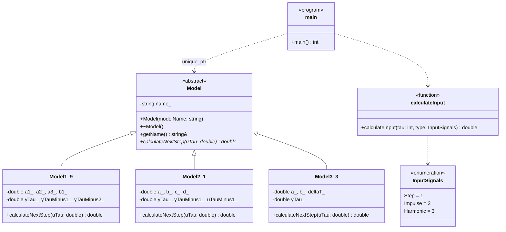
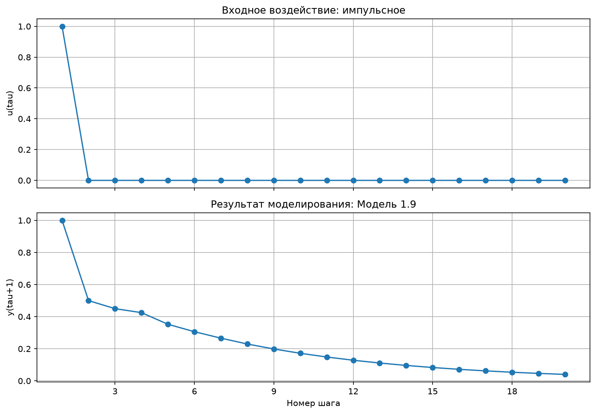
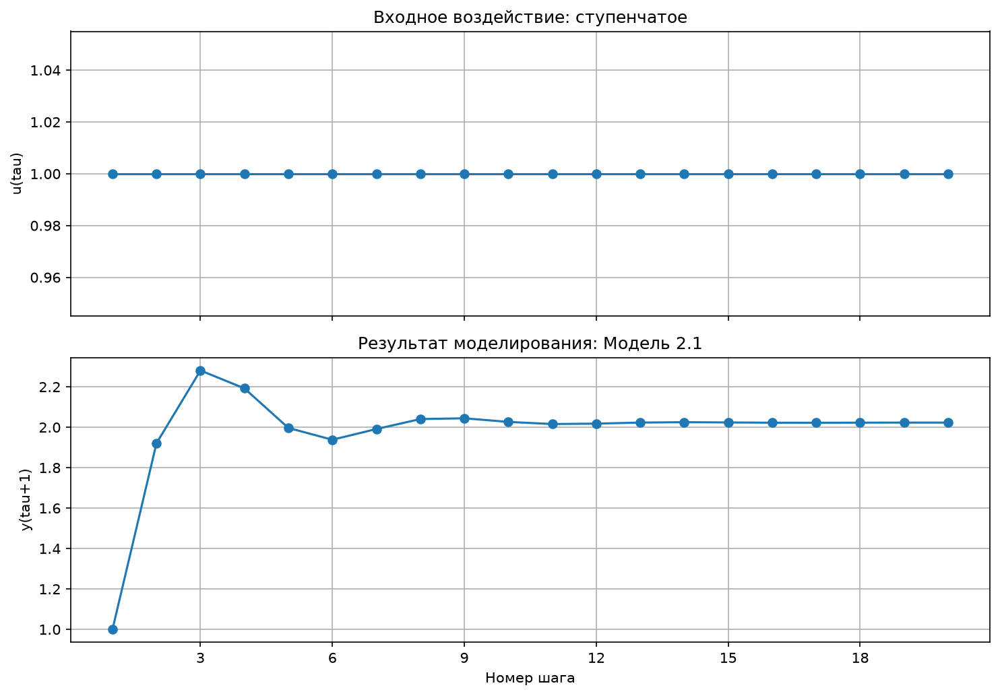
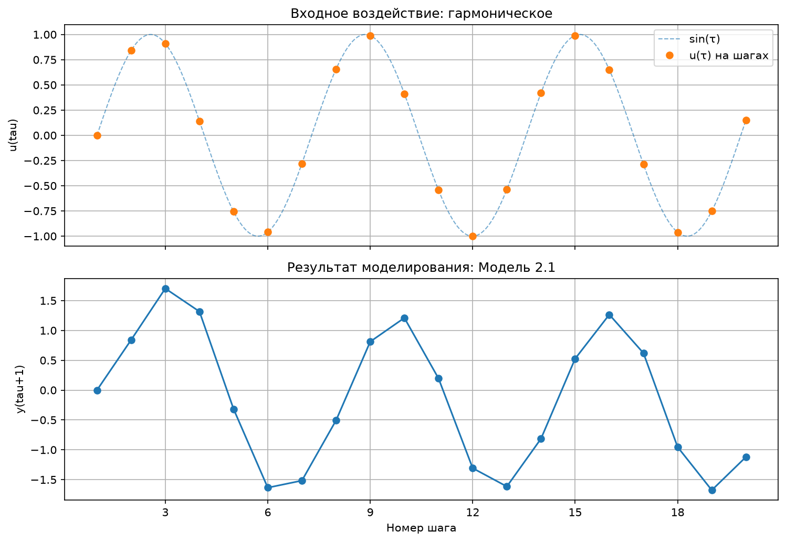

<p align="center">Министерство образования Республики Беларусь</p>

<p align="center">Учреждение образования</p>

<p align="center">«Брестский государственный технический университет»</p>

<p align="center">Кафедра ИИТ</p>

<br><br><br><br>

<p align="center"><strong>ЛАБОРАТОРНАЯ РАБОТА № 1</strong></p>

<p align="center">по дисциплине «Теория и моделирование автоматического управления»</p>

<p align="center">Тема: «Моделирование объектов управления»</p>

<br><br><br>

<p align="right">Выполнил:</p>
<p align="right">Студент 3 курса</p>
<p align="right">Группы АС-68</p>
<p align="right">Жуков А. А.</p>

<br>

<p align="right">Проверил:</p>
<p align="right">Дворанинович Д. А.</p>

<br><br><br>

<p align="center">Брест 2026</p>

---

## Вариант и используемые модели

В программе реализованы модели 1.9, 2.1 и 3.3. Согласно таблице соответствия моделей вариантам, эта комбинация соответствует **варианту 9**.

| Тип модели | Модель |
|---|---|
| Линейная | Model 1.9 |
| Нелинейная | Model 2.1 |
| Дифференциальная | Model 3.3 |

## 1. Цель работы

Разработать программу на языке C++ для имитационного моделирования объектов управления. Изучить реакцию линейной, нелинейной и дифференциальной моделей на ступенчатое, импульсное и гармоническое входные воздействия. Организовать вывод результатов в таблицу, сохранение данных в CSV и визуализацию графиков. Реализовать объектно-ориентированную структуру и сборку проекта с помощью CMake.

## 2. Соответствие требованиям задания

| Требование | Реализация |
|---|---|
| Отчёт в формате Markdown | Данный файл `doc/readme.md` |
| Исходный код в каталоге `src` | `main.cpp`, `model.h`, `CMakeLists.txt`, `build.bat`, `visualise.py` |
| Не менее двух рецензий на работы других студентов | Ссылки указаны в разделе 13; перед сдачей необходимо проверить их актуальность |
| Настройка числа шагов `n` | Значение задаётся пользователем при запуске |
| Табличный вывод и экспорт | Консольная таблица и файл `result.csv` |
| Визуализация | Python и Matplotlib |
| UML-диаграмма классов | Раздел 6 |
| ООП и наследование от абстрактного класса | `Model`, `Model1_9`, `Model2_1`, `Model3_3` |
| Три входных воздействия | Ступенчатое, импульсное и гармоническое |
| Сборка CMake через `.bat` | `CMakeLists.txt` и `build.bat` |

## 3. Математические модели

Обозначения: $\tau$ — индекс дискретного шага; $u_\tau$ — входное воздействие; $y_\tau$ — значение выхода объекта; $n$ — число шагов моделирования. В реализованных классах начальные значения выходных сигналов и истории входа равны нулю, если отдельно не предусмотрено иное.

### 3.1. Линейная модель 1.9

Модель использует текущее значение входа и три значения выхода:

$$
y_{\tau+1}=a_1y_\tau+a_2y_{\tau-1}+a_3y_{\tau-2}+b_1u_\tau.
$$

В программе заданы коэффициенты $a_1=0.5$, $a_2=0.2$, $a_3=0.1$, $b_1=1.0$. Начальные состояния: $y_0=y_{-1}=y_{-2}=0$. После вычисления очередного значения история выхода сдвигается на один шаг.

### 3.2. Нелинейная модель 2.1

Модель учитывает квадратичную обратную связь по предыдущему выходу и гармоническую составляющую от предыдущего входа:

$$
y_{\tau+1}=ay_\tau-by_{\tau-1}^{2}+cu_\tau+d\sin(u_{\tau-1}).
$$

Используемые коэффициенты: $a=0.5$, $b=0.1$, $c=1.0$, $d=0.5$. Начальные значения: $y_0=y_{-1}=u_{-1}=0$. После расчёта обновляются значения выхода и предыдущего входа.

### 3.3. Дифференциальная модель 3.3

Объект описывается дифференциальным уравнением первого порядка:

$$
\frac{dy}{dt}=-ay+bu.
$$

Для численного решения используется явный метод Эйлера с шагом $\Delta t$:

$$
y_{\tau+1}=y_\tau+\Delta t(-ay_\tau+bu_\tau).
$$

В экспериментах используются $a=1.0$, $b=1.0$, $\Delta t=0.2$ и $y_0=0$. Для этих коэффициентов множитель свободной составляющей равен $1-a\Delta t=0.8$, поэтому при нулевом входе выход затухает, а при постоянном входе стремится к установившемуся значению $b/a=1$.

## 4. Входные воздействия

| Воздействие | Формула | Реализация |
|---|---|---|
| Ступенчатое | $u_\tau=1$ | На каждом шаге вход равен единице |
| Импульсное | $u_0=1$, $u_\tau=0$ при $\tau>0$ | Единица только на первом рассчитываемом шаге |
| Гармоническое | $u_\tau=\sin(\tau)$ | Синус от номера шага в радианах |

Внутренний индекс начинается с $\tau=0$, а в консольной таблице шаг выводится с единицы. Поэтому строка с номером шага 1 соответствует входу $u_0$.

## 5. Структура проекта

```text
trunk/as06806/task_01/
├── src/
│   ├── main.cpp          — меню, ввод параметров, цикл моделирования, таблица и CSV
│   ├── model.h           — абстрактный класс, реализации моделей и входные сигналы
│   ├── visualise.py      — чтение CSV, вывод таблицы и построение графиков
│   ├── CMakeLists.txt    — конфигурация CMake
│   └── build.bat         — конфигурация, сборка, запуск и визуализация
└── doc/
    ├── readme.md         — отчёт по лабораторной работе
    └── Model_*.png       — графики, создаваемые скриптом визуализации
```

После выполнения `build.bat` программа создаёт `result.csv` в каталоге `src`. Скрипт `visualise.py` сохраняет график и копию CSV в `doc`. Эти выходные файлы формируются при запуске; их наличие в репозитории зависит от того, были ли они добавлены в Git.

## 6. Объектно-ориентированная архитектура

В базовом абстрактном классе `Model` хранится название модели и объявляется чисто виртуальный метод `calculateNextStep(double uTau)`. Конкретные классы наследуют этот интерфейс и реализуют свои уравнения. Благодаря этому общий цикл моделирования может работать с объектом через указатель `std::unique_ptr<Model>`, не проверяя тип модели на каждом шаге расчёта.

| Принцип ООП | Применение в программе |
|---|---|
| Абстракция | `Model` задаёт общий интерфейс расчёта следующего шага |
| Наследование | `Model1_9`, `Model2_1` и `Model3_3` наследуют `Model` |
| Инкапсуляция | Коэффициенты и внутренние состояния хранятся в закрытых полях классов |
| Полиморфизм | Виртуальный метод вызывается через указатель на базовый класс |

### UML-диаграмма классов



*Рисунок 1 — UML-диаграмма классов программы.*

## 7. Ввод, вывод и обработка ошибок

При запуске программа последовательно запрашивает:

1. количество шагов моделирования $n$;
2. номер модели (1, 2 или 3);
3. коэффициенты выбранной модели;
4. номер входного воздействия (1, 2 или 3).

Количество шагов должно быть положительным целым числом. Ввод коэффициентов проверяется на корректность и конечность значения. Для модели 3.3 отдельно проверяется, что $\Delta t>0$. Если входные данные не прошли проверку, программа выводит сообщение и прекращает выполнение. Во время расчёта проверяется, что полученное значение выхода является конечным и не превышает по модулю установленный порог $10^9$; при обнаружении расходимости расчёт останавливается.

Таблица в консоли содержит номер шага, вход $u_\tau$ и вычисленный выход $y_{\tau+1}$. Эти данные записываются также в `result.csv` со столбцами `step`, `u_tau`, `y_next`, `model`, `signal`. Для CSV используется классическая локаль, поэтому десятичный разделитель — точка.

### Пример результата

Для модели 1.9 при $a_1=0.5$, $a_2=0.2$, $a_3=0.1$, $b_1=1.0$, ступенчатом входе и $n=5$ получаем:

| Шаг | $u_\tau$ | $y_{\tau+1}$ |
|---:|---:|---:|
| 1 | 1.0000 | 1.0000 |
| 2 | 1.0000 | 1.5000 |
| 3 | 1.0000 | 1.9500 |
| 4 | 1.0000 | 2.3750 |
| 5 | 1.0000 | 2.7275 |

## 8. Результаты моделирования и графики

Для сравнения моделей использованы $n=20$ шагов. Применённые коэффициенты сведены в таблицу.

| Модель | Параметры |
|---|---|
| 1.9 | $a_1=0.5$, $a_2=0.2$, $a_3=0.1$, $b_1=1.0$ |
| 2.1 | $a=0.5$, $b=0.1$, $c=1.0$, $d=0.5$ |
| 3.3 | $a=1.0$, $b=1.0$, $\Delta t=0.2$ |

### 8.1. Линейная модель 1.9

Параметры: $a_1=0.5$, $a_2=0.2$, $a_3=0.1$, $b_1=1.0$.

| Ступенчатое воздействие | Импульсное воздействие | Гармоническое воздействие |
|---|---|---|
|  |  |  |

*Рисунок 2 — отклик модели 1.9 на три входных воздействия.*

<details>
<summary>Таблица выхода за 20 шагов для модели 1.9</summary>

| Шаг | Ступенчатый вход | Импульсный вход | Гармонический вход |
|---:|---:|---:|---:|
| 1 | 1.0000 | 1.0000 | 0.0000 |
| 2 | 1.5000 | 0.5000 | 0.8415 |
| 3 | 1.9500 | 0.4500 | 1.3300 |
| 4 | 2.3750 | 0.4250 | 0.9744 |
| 5 | 2.7275 | 0.3525 | 0.0806 |
| 6 | 3.0337 | 0.3063 | -0.5908 |
| 7 | 3.2999 | 0.2661 | -0.4612 |
| 8 | 3.5294 | 0.2296 | 0.3163 |
| 9 | 3.7281 | 0.1986 | 0.9962 |
| 10 | 3.8999 | 0.1718 | 0.9273 |
| 11 | 4.0485 | 0.1486 | 0.1505 |
| 12 | 4.1770 | 0.1285 | -0.6397 |
| 13 | 4.2882 | 0.1112 | -0.7336 |
| 14 | 4.3844 | 0.0962 | -0.0595 |
| 15 | 4.4675 | 0.0832 | 0.7502 |
| 16 | 4.5395 | 0.0719 | 0.9401 |
| 17 | 4.6017 | 0.0622 | 0.3262 |
| 18 | 4.6555 | 0.0538 | -0.5352 |
| 19 | 4.7020 | 0.0465 | -0.8593 |
| 20 | 4.7423 | 0.0403 | -0.3542 |

</details>

### 8.2. Нелинейная модель 2.1

Параметры: $a=0.5$, $b=0.1$, $c=1.0$, $d=0.5$.

| Ступенчатое воздействие | Импульсное воздействие | Гармоническое воздействие |
|---|---|---|
|  |  |  |

*Рисунок 3 — отклик модели 2.1 на три входных воздействия.*

<details>
<summary>Таблица выхода за 20 шагов для модели 2.1</summary>

| Шаг | Ступенчатый вход | Импульсный вход | Гармонический вход |
|---:|---:|---:|---:|
| 1 | 1.0000 | 1.0000 | 0.0000 |
| 2 | 1.9207 | 0.9207 | 0.8415 |
| 3 | 2.2811 | 0.3604 | 1.7028 |
| 4 | 2.1924 | 0.0954 | 1.3163 |
| 5 | 1.9966 | 0.0347 | -0.3183 |
| 6 | 1.9384 | 0.0164 | -1.6346 |
| 7 | 1.9913 | 0.0081 | -1.5162 |
| 8 | 2.0407 | 0.0040 | -0.5062 |
| 9 | 2.0445 | 0.0020 | 0.8118 |
| 10 | 2.0266 | 0.0010 | 1.2102 |
| 11 | 2.0160 | 0.0005 | 0.1955 |
| 12 | 2.0180 | 0.0003 | -1.3075 |
| 13 | 2.0233 | 0.0001 | -1.6149 |
| 14 | 2.0251 | 0.0001 | -0.8138 |
| 15 | 2.0239 | 0.0000 | 0.5269 |
| 16 | 2.0226 | 0.0000 | 1.2657 |
| 17 | 2.0224 | 0.0000 | 0.6199 |
| 18 | 2.0229 | 0.0000 | -0.9536 |
| 19 | 2.0232 | 0.0000 | -1.6762 |
| 20 | 2.0231 | 0.0000 | -1.1204 |

</details>

### 8.3. Дифференциальная модель 3.3

Параметры: $a=1.0$, $b=1.0$, $\Delta t=0.2$.

| Ступенчатое воздействие | Импульсное воздействие | Гармоническое воздействие |
|---|---|---|
|  |  |  |

*Рисунок 4 — отклик модели 3.3 на три входных воздействия.*

<details>
<summary>Таблица выхода за 20 шагов для модели 3.3</summary>

| Шаг | Ступенчатый вход | Импульсный вход | Гармонический вход |
|---:|---:|---:|---:|
| 1 | 0.2000 | 0.2000 | 0.0000 |
| 2 | 0.3600 | 0.1600 | 0.1683 |
| 3 | 0.4880 | 0.1280 | 0.3165 |
| 4 | 0.5904 | 0.1024 | 0.2814 |
| 5 | 0.6723 | 0.0819 | 0.0738 |
| 6 | 0.7379 | 0.0655 | -0.1328 |
| 7 | 0.7903 | 0.0524 | -0.1621 |
| 8 | 0.8322 | 0.0419 | 0.0017 |
| 9 | 0.8658 | 0.0336 | 0.1992 |
| 10 | 0.8926 | 0.0268 | 0.2418 |
| 11 | 0.9141 | 0.0215 | 0.0847 |
| 12 | 0.9313 | 0.0172 | -0.1323 |
| 13 | 0.9450 | 0.0137 | -0.2131 |
| 14 | 0.9560 | 0.0110 | -0.0865 |
| 15 | 0.9648 | 0.0088 | 0.1289 |
| 16 | 0.9719 | 0.0070 | 0.2332 |
| 17 | 0.9775 | 0.0056 | 0.1290 |
| 18 | 0.9820 | 0.0045 | -0.0891 |
| 19 | 0.9856 | 0.0036 | -0.2215 |
| 20 | 0.9885 | 0.0029 | -0.1472 |

</details>

## 9. Анализ результатов

- **Модель 1.9.** При ступенчатом воздействии выход последовательно возрастает и приближается к установившемуся значению $y_\infty=b_1/(1-a_1-a_2-a_3)=5$. При импульсном воздействии отклик убывает после начального скачка. При гармоническом входе выход также колеблется, но его форма определяется динамическими коэффициентами модели.
- **Модель 2.1.** Квадратичный член $-by_{\tau-1}^2$ и слагаемое $d\sin(u_{\tau-1})$ делают зависимость нелинейной. При ступенчатом воздействии выход после начального переходного процесса приближается к значению около 2.02 для выбранных коэффициентов. При импульсе отклик затухает, а гармоническое воздействие вызывает колебания с нелинейным откликом.
- **Модель 3.3.** При ступенчатом воздействии выход приближается к $b/a=1$. При импульсном воздействии после начального значения выход уменьшается с коэффициентом $0.8$ на каждом следующем шаге. При гармоническом входе модель сглаживает изменения входа, поэтому амплитуда выхода отличается от амплитуды входного сигнала.

## 10. Проверка корректности

Контрольные расчёты выполнены по формулам моделей с теми же коэффициентами, которые используются в экспериментальной таблице. Первые значения выхода для ступенчатого входа:

| Модель | Первые значения $y_{\tau+1}$ |
|---|---|
| 1.9 | 1.0000; 1.5000; 1.9500; 2.3750; 2.7275 |
| 2.1 | 1.0000; 1.9207; 2.2811; 2.1924; 1.9966 |
| 3.3 | 0.2000; 0.3600; 0.4880; 0.5904; 0.6723 |

При ручной проверке необходимо сравнивать значения с таблицей программы с учётом округления до четырёх знаков после запятой. Дополнительно следует проверить ошибочные варианты ввода: неположительное `n`, номер модели или сигнала вне диапазона 1–3, нечисловые коэффициенты и неположительное $\Delta t$ для модели 3.3. Для проверки остановки при расходимости можно задать коэффициенты нелинейной модели, вызывающие быстрое увеличение выхода; программа должна вывести сообщение об ошибке вместо продолжения вывода некорректных значений.

## 11. Сборка и запуск

Для сборки требуется CMake и установленный C++-компилятор. Для построения графиков необходимы Python 3, NumPy и Matplotlib. Скрипт `build.bat` автоматически переходит в каталог `src`, выполняет конфигурацию CMake, собирает программу, запускает её и затем запускает визуализацию.

Последовательность этапов, выводимая в консоль:

1. `CONFIGURE PROJECT` — `cmake -S . -B build`;
2. `BUILD PROJECT` — `cmake --build build --config Release`;
3. `RUN PROGRAM` — запуск `task_01.exe`;
4. `VISUALISATION` — проверка Matplotlib и запуск `visualise.py result.csv`.

Чтобы выполнить моделирование, запустите `build.bat` из проводника или терминала. Введите количество шагов, выберите модель, задайте её коэффициенты и выберите входное воздействие. После завершения расчёта скрипт выводит таблицу, строит графики и сохраняет результаты в каталог `doc`. Для просмотра всех девяти комбинаций нужно запустить программу отдельно для каждой пары «модель — входное воздействие».

В корневом CMake-проекте репозитория каждая студенческая работа должна иметь уникальное имя цели. Для этой работы используется цель `task_01_as06806`, а имя выходного исполняемого файла сохранено как `task_01`, чтобы его находил `build.bat`. Если в локальном `CMakeLists.txt` это изменение ещё не внесено, необходимо согласовать имя цели с текущей версией файла сборки.

## 12. Заключение

В ходе лабораторной работы разработана программа моделирования трёх объектов управления на языке C++. Линейная модель 1.9, нелинейная модель 2.1 и дифференциальная модель 3.3 реализованы отдельными классами-наследниками абстрактного класса `Model`. Программа позволяет задавать число шагов и коэффициенты, выбирать один из трёх входных сигналов, отображать расчётные данные в консоли и сохранять их в CSV. Для анализа отклика используется Python и Matplotlib. Сборка и запуск автоматизированы с помощью CMake и пакетного файла `build.bat`. Полученные таблицы и графики позволяют сравнить переходные процессы моделей при разных входных воздействиях.

## 13. Рецензирование и размещение работы

| № | Действие | Ссылка |
|---:|---|---|
| 1 | Рецензия 1 | [Обсуждение в PR №5](https://github.com/brstu/TMAU-2026/pull/5#discussion_r4319880446) |
| 2 | Рецензия 2 | [Обсуждение в PR №5](https://github.com/brstu/TMAU-2026/pull/5#discussion_r4319919653) |
| 3 | Pull request с лабораторной работой | [PR №15](https://github.com/brstu/TMAU-2026/pull/15) |
